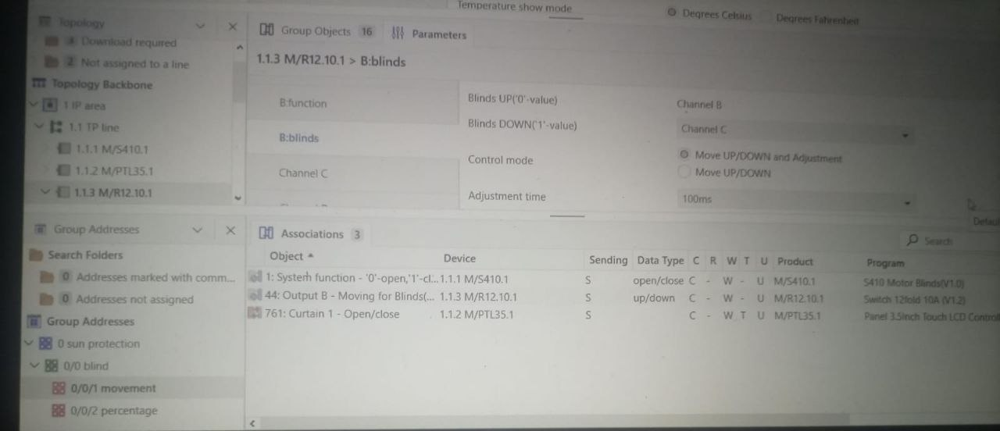

# KNX Educational Board for Home Automation

Our graduation project in Avionics Engineering at Al-Furat Al-Awsat Technical University (2024): a training board for learning how to install and program a KNX home-automation system. We were a team of six, and my grade for the project was 96/100.

## My part

- All the ETS programming (ETS5 / ETS6): device parameters, group addresses and the links between the devices.
- Writing the project report.

The hardware was installed with help from a technician outside the team.

## What's on the board

- KNX gateway and two power supplies (960 mA and 750 mA)
- 12-channel 10 A switch actuator
- 4-channel MOSFET dimmer
- 3.5-inch touch panel
- Sensor and curtain motor

Wiring diagram: [testing_fill.pdf](testing_fill.pdf)

## ETS

Group address 0/0/1 links the touch panel's curtain button to the blinds channel on the 12-channel actuator and to the curtain motor.

## Demo video

[Watch on Google Drive](https://drive.google.com/file/d/1ytonCnBUaunHc5607_j_-Sb_1Wf6reZ7/view)
